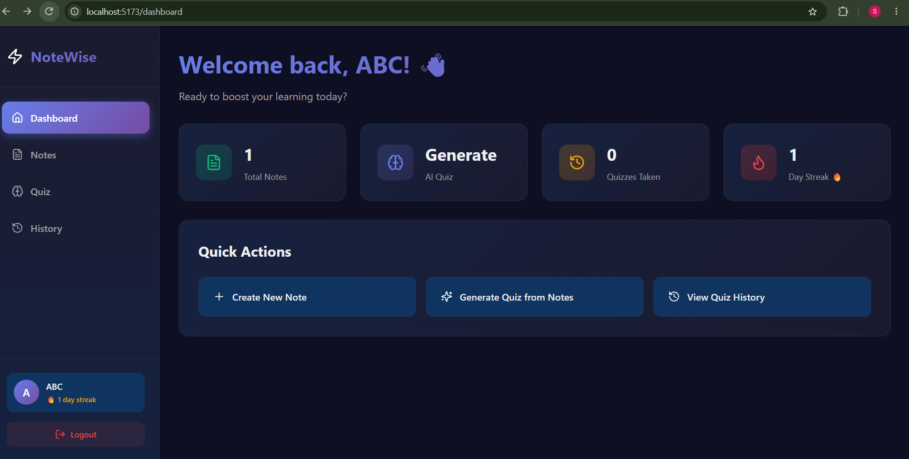

# NoteWise

NoteWise is a smart, modern note-taking web application that helps users organize their notes, reinforce learning through AI-generated quizzes, track their daily activity streaks, and review past quiz performance. Built with a clean dark UI and powered by Google Gemini AI, NoteWise transforms passive note-taking into an active learning experience.

## Problem Statement

Students and learners often struggle to retain information from their notes. Simply reading them repeatedly isn't effective for long-term retention. There is a need for a tool that:
- Helps users organize and manage their notes efficiently
- Automatically generates practice questions from their own notes
- Provides instant feedback on quiz performance
- Encourages consistent learning through motivation (streaks)
- Allows users to track their progress over time

## Solution

NoteWise solves this problem by combining note management with AI-powered active recall. Users can create notes, select any subset of them, and generate personalized multiple-choice quizzes using Google Gemini AI. After attempting quizzes, they can review detailed results, track their learning history, and maintain daily streaks to build a consistent study habit.

## Features

### Authentication
- **User Registration** - Secure signup with name, email, and password
- **User Login** - JWT-based authentication for secure sessions
- **Protected Routes** - All notes and quiz features are accessible only to authenticated users

### Notes Management (CRUD)
- **Create Notes** - Add notes with titles and rich content
- **View Notes** - Browse all notes in an elegant card-based layout
- **Update Notes** - Edit existing notes via an intuitive modal
- **Delete Notes** - Remove notes with confirmation prompt
- **Auto-Streak Update** - Creating/updating notes contributes to daily streak

### AI-Powered Quiz Generation
- **Smart Question Generation** - Leverages Google Gemini 2.0 Flash to create context-aware MCQs from selected notes
- **Multi-Note Selection** - Generate quizzes from one or multiple notes at once
- **Intelligent Questions** - Focuses on understanding and application, not just rote memorization
- **Fallback Support** - Gracefully handles API issues with fallback questions

### Quiz Taking & Evaluation
- **Interactive Quiz Interface** - Clean, distraction-free question-by-question experience
- **Instant Scoring** - Automatic calculation of percentage and correct/wrong counts
- **Detailed Results** - Comprehensive review showing correct answers, explanations, and mistakes
- **Performance Insights** - Motivational feedback based on score range

### Quiz History & Progress Tracking
- **Complete History** - View all past quiz attempts with timestamps and scores
- **Detailed Review** - Revisit any previous quiz with full question breakdown
- **Score Visualization** - Easy-to-scan history cards showing performance

### Streak Tracking
- **Daily Streak Counter** - Tracks consecutive days of learning activity
- **Auto-Update** - Increments on creating notes or completing quizzes
- **Smart Logic** - Resets streak if a day is missed, maintains if same day
- **Motivational Display** - Streak prominently shown in sidebar and dashboard

### User Experience
- **Modern Dark UI** - Sleek gradient-based design with smooth animations
- **Responsive Layout** - Works seamlessly across different screen sizes
- **Intuitive Navigation** - Sidebar with easy access to all features
- **Real-time Feedback** - Loading states and confirmation prompts throughout

## Tech Stack

| Layer | Technology | Purpose |
| --- | --- | --- |
| **Frontend** | [React 19](https://react.dev/) | Component-based UI library |
| **Build Tool** | [Vite](https://vitejs.dev/) | Fast development and optimized builds |
| **Routing** | [React Router DOM v7](https://reactrouter.com/) | Client-side routing |
| **HTTP Client** | [Axios](https://axios-http.com/) | API requests |
| **Icons** | [Lucide React](https://lucide.dev/) | Beautiful, consistent icons |
| **Backend** | [Node.js](https://nodejs.org/) + [Express 5](https://expressjs.com/) | RESTful API server (ES Modules) |
| **Database** | [SQLite3](https://www.sqlite.org/) | Lightweight, file-based SQL database |
| **Authentication** | [JSON Web Tokens (JWT)](https://jwt.io/) | Secure token-based auth |
| **Password Security** | [bcryptjs](https://github.com/dcodeIO/bcrypt.js) | Password hashing |
| **AI Integration** | [Google Gemini API](https://ai.google.dev/) | AI-powered quiz generation |

## Architecture

```
NoteWise/
│
├── client/                    # Frontend (React + Vite)
│   ├── src/
│   │   ├── components/       # Reusable components (Layout)
│   │   ├── context/          # Auth context provider
│   │   ├── pages/            # Page components (Dashboard, Notes, Quiz, etc.)
│   │   └── App.jsx           # Main app with routing
│   └── package.json
│
├── backend/                   # Backend (Node.js + Express)
│   ├── controllers/          # Business logic (auth, notes, quiz)
│   ├── middleware/           # Auth middleware (JWT verification)
│   ├── routes/               # API route definitions
│   ├── utils/                # Helper functions (streak calculation)
│   ├── db.js                 # SQLite connection & initialization
│   ├── server.js             # Express server entry point
│   └── package.json
│
└── README.md
```

### Data Flow

1. **Client** makes HTTP requests to the backend API with JWT tokens in headers
2. **Express Middleware** authenticates requests using JWT
3. **Controllers** handle business logic and interact with SQLite database
4. **Quiz Generation** sends note content to Google Gemini API and processes the response
5. **Database** stores users, notes, and quiz data in `notewise.db`
6. **Client** updates UI reactively based on API responses

### Database Schema

```sql
users (id, name, email, password, current_streak, last_activity_date, created_at)
notes (id, user_id, title, content, created_at, updated_at)
quizzes (id, user_id, questions, note_ids, user_answers, score, created_at, completed_at)
```

## Getting Started

### Prerequisites

- [Node.js](https://nodejs.org/) (v18 or higher)
- [Google Gemini API Key](https://aistudio.google.com/apikey) (for AI quiz generation)

### Installation & Setup

#### 1. Clone the Repository
```bash
git clone <repository-url>
cd NoteWise
```

#### 2. Backend Setup
```bash
cd backend
npm install
```

Create a `.env` file in the `backend` directory:
```env
PORT=5000
JWT_SECRET=your_secure_jwt_secret_here
GEMINI_API_KEY=your_gemini_api_key_here
```

Start the backend server:
```bash
npm start
```

The server will run on `http://localhost:5000` and automatically create `notewise.db` on first launch.

#### 3. Frontend Setup
Open a new terminal window:
```bash
cd client
npm install
```

Create a `.env` file in the `client` directory:
```env
VITE_API_URL=http://localhost:5000
```

Start the frontend development server:
```bash
npm run dev
```

The app will be available at `http://localhost:5173`

### Usage Guide

1. **Sign Up** - Create a new account on the signup page
2. **Dashboard** - Get an overview of your notes, quizzes, and current streak
3. **Create Notes** - Navigate to Notes and click "Create Note" to add your study material
4. **Generate Quiz** - Go to Quiz, select one or more notes, and click "Generate Quiz with AI"
5. **Take Quiz** - Answer all multiple-choice questions and submit
6. **View Results** - See your score, correct/wrong answers, and explanations
7. **Track Progress** - Check Quiz History to review all past attempts
8. **Build Streak** - Stay consistent by creating notes or taking quizzes daily

## Screenshots

### Sign Up / Sign In


### Dashboard


## Future Enhancements

- [ ] Rich text editor for notes (formatting, lists, etc.)
- [ ] Note categories/tags for better organization
- [ ] Multiple quiz difficulty levels
- [ ] Flashcard mode for quick revisio


## Deployment Status

> **Note:** This application is **not currently deployed** and is intended for **local development/testing only**. It is **not production-ready** in its current state.

### Known Limitations Before Production
- **No Hosting** - Frontend and backend are not deployed to any cloud platform
- **Local Database Only** - Uses SQLite (`notewise.db`) which is not suitable for multi-instance production deployments
- **Environment Security** - Requires proper secret management and HTTPS in production
- **Error Handling** - Some edge cases around LLM responses need additional hardening
- **No CI/CD** - No automated testing or deployment pipeline configured yet

## Testing & CI/CD Plan

To make this production-ready, the following work is required:

### API Testing
- [ ] **Unit Tests** - Test controllers, middleware, and utility functions
- [ ] **Integration Tests** - Test API endpoints for auth, notes, and quiz flows
- [ ] **End-to-End Tests** - Validate complete user flows (signup → create notes → generate quiz → submit)
- [ ] **Database Tests** - Test SQLite operations and data integrity

### CI/CD Pipeline
- [ ] **GitHub Actions Setup** - Create workflows for linting, testing, and building
- [ ] **Automated Testing** - Run tests on every push/PR
- [ ] **Build Verification** - Ensure frontend and backend build successfully
- [ ] **Environment Validation** - Check required environment variables
- [ ] **Deployment Automation** - Auto-deploy to staging/production on merge to main

### LLM Integration Testing & Validation
- [ ] **LLM Response Validation** - Add strict schema validation for Gemini API responses (ensure questions, options, correctAnswer, and explanation exist)
- [ ] **Fallback Handling** - Improve error handling when LLM fails to generate valid answers or returns malformed JSON
- [ ] **Retry Logic** - Implement retry mechanism for transient API failures
- [ ] **Prompt Engineering** - Test and refine prompts to consistently generate valid quiz formats
- [ ] **Rate Limiting** - Add protection against excessive API calls
- [ ] **Cost Monitoring** - Track Gemini API usage
- [ ] **Timeout Handling** - Handle slow LLM responses gracefully

### Containerization & Deployment
- [ ] **Dockerize Backend** - Create optimized `Dockerfile` for Node.js/Express backend
- [ ] **Dockerize Frontend** - Create multi-stage `Dockerfile` for React/Vite frontend with Nginx
- [ ] **Docker Compose** - Write `docker-compose.yml` for local containerized development
- [ ] **Container Registry** - Push images to Docker Hub/GHCR
- [ ] **Cloud Deployment** - Deploy containers to platforms like Railway, Render, Fly.io, or AWS (with persistent storage for SQLite or migrate to managed DB)
- [ ] **Reverse Proxy & HTTPS** - Set up proper networking, CORS, and SSL certificates
- [ ] **Monitoring & Logging** - Add application monitoring and logging solutions
